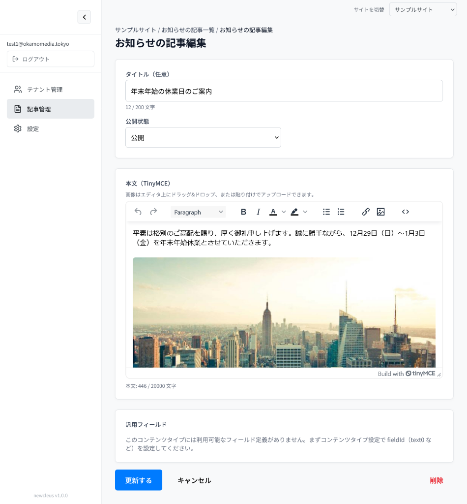
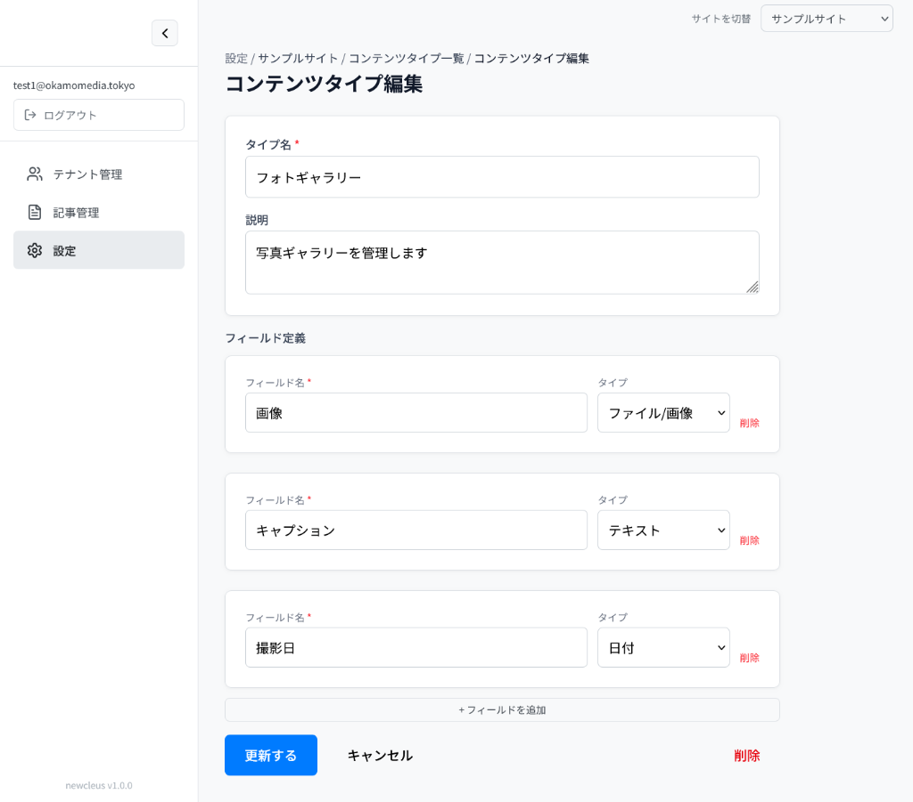
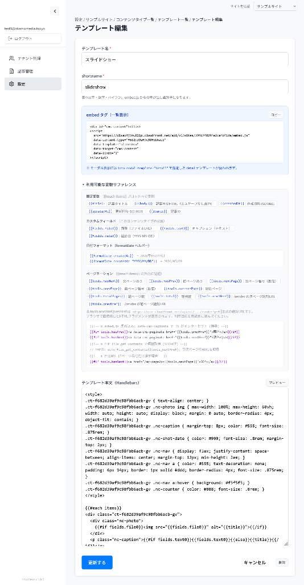
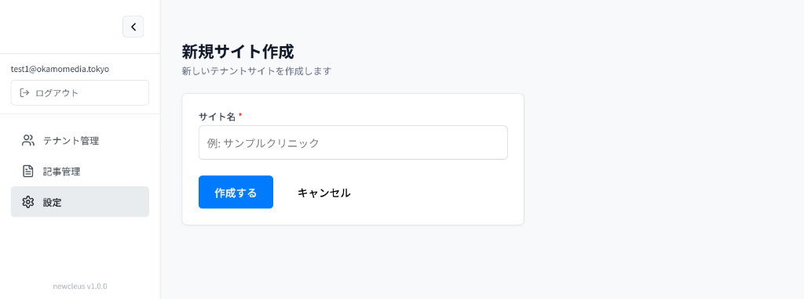
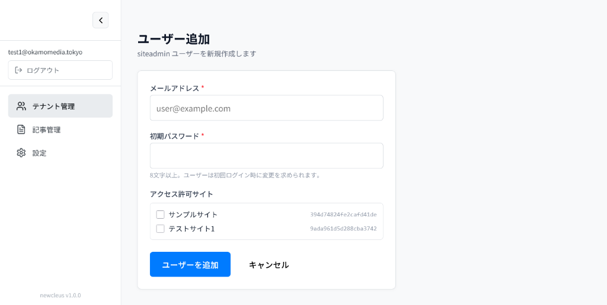
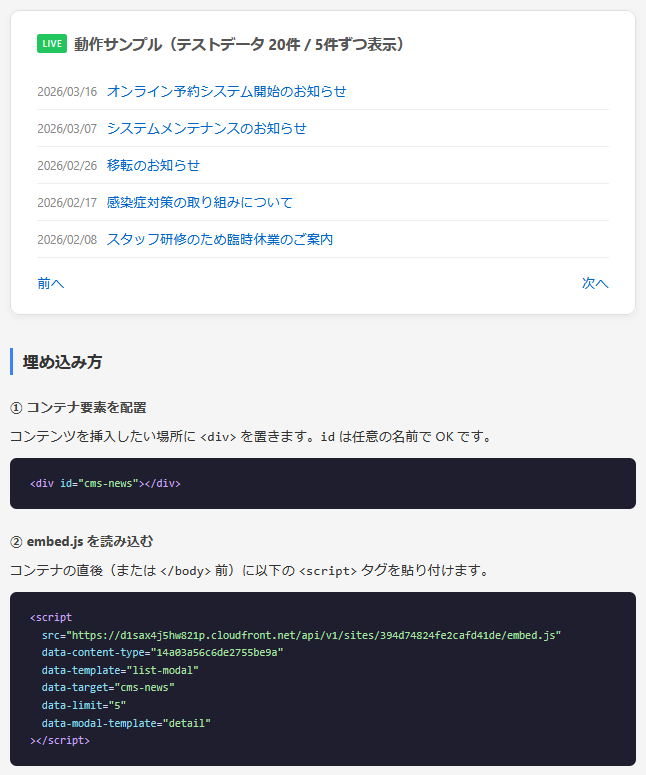
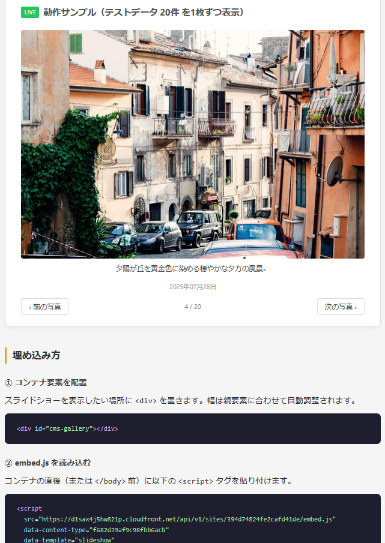
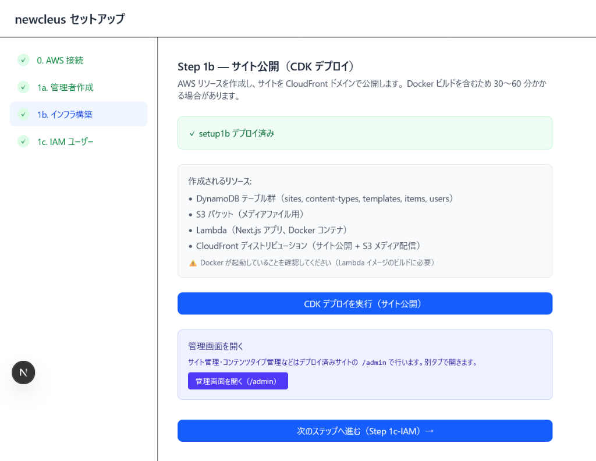
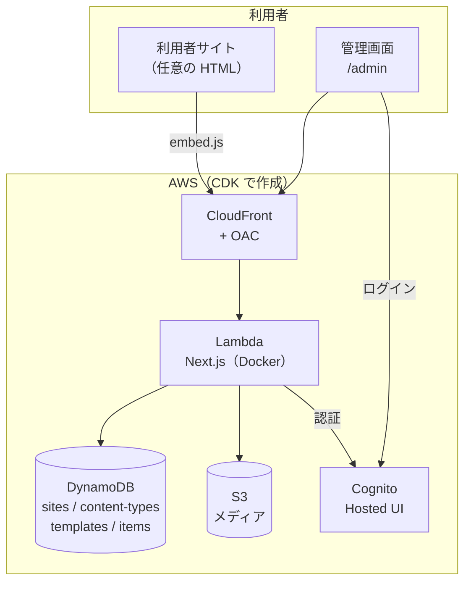

# newcleus

<p align="center">
  <a href="https://github.com/okamoto53515606/newcleus/releases/latest"></a>
  
  
  <a href="LICENSE"></a>
</p>

**script タグ 1 行で、あなたのサイトに CMS を。**

小規模サイト向けのマルチテナント CMS。管理画面で作った「お知らせ」や「フォトギャラリー」を、既存サイトに `<div>` と `<script>` を 1 行ずつ貼るだけで表示できます。サーバーは AWS のサーバーレス構成（Cognito / DynamoDB / S3 / Lambda / CloudFront）で、常時運用するサーバーはありません。

<p align="center">
  
  <br>
  <sub>記事編集画面（TinyMCE）。画像はドラッグ &amp; ドロップでアップロードできます。</sub>
</p>

<p align="center">
  <a href="#はじめかた">はじめかた</a> ｜ <a href="#できること">できること</a> ｜ <a href="#埋め込み方">埋め込み方</a> ｜ <a href="#アーキテクチャ">アーキテクチャ</a> ｜ <a href="#ドキュメント">ドキュメント</a>
</p>

> 名前の由来: "new" + "Nucleus CMS"。20 年前の Nucleus CMS（PHP）の設計思想をリスペクトしつつ、モダンな技術で作り直したプロジェクトです。設計の背景は [blueprint](docs/blueprint.md) にまとめています。

---

## できること

| 機能 | 概要 |
| --- | --- |
| 📝 **記事管理** | TinyMCE による WYSIWYG 編集。下書き／公開のステータス管理、画像アップロード（S3）に対応。 |
| 🧩 **カスタム項目** | タイトル・本文に加えて、テキスト／ファイル／フラグ／日付／数値の独自フィールドを自由に定義。 |
| 🖼 **テンプレート** | Handlebars テンプレートで表示を自由に。一覧・モーダル・詳細・スライドショーなど、サイト作成時に初期セットが入ります。 |
| 👥 **マルチテナント** | 1 つの SaaS 上で複数サイトを運用。`admin`（運営者）は全サイト、`siteadmin`（利用者）は自分のサイトだけを操作できます。 |
| 🚀 **セットアップ画面からデプロイ** | ブラウザ上のセットアップ画面から CDK を実行し、AWS リソース一式を作成します。 |

### 想定される使い方

「記事 CMS」ですが、汎用フィールドと埋め込み JS の組み合わせで記事以外にも使えます。

| 用途 | 1 件 = | フィールド例 |
| --- | --- | --- |
| お知らせ・ニュース | 1 お知らせ | `flag0`=緊急, `date0`=掲載日 |
| スタッフ紹介 | 1 人 | `file0`=写真, `text0`=役職 |
| フォトギャラリー | 1 枚の写真 | `file0`=画像, `text0`=キャプション, `date0`=撮影日 |
| バナー管理 | 1 バナー | `file0`=画像, `text0`=リンク, `date0`/`date1`=掲載期間 |

## スクリーンショット

### カスタム項目（コンテンツタイプ設定）



### テンプレート編集



### サイト（テナント）作成



### テナント管理者の追加



## 埋め込み方

管理画面（`/admin`）で記事を作り、公開サイト側は次の 2 行だけ。

```html
<div id="cms-news"></div>
<script src="https://<your-distribution>.cloudfront.net/api/v1/sites/<siteId>/embed.js?contentType=<ctId>&template=list-modal&limit=5"></script>
```

用途に応じて 3 つの取得方法を選べます。

| 方法 | SEO | 難易度 | 向いている用途 |
| --- | --- | --- | --- |
| `embed.js`（script 埋め込み） | × | ★☆☆ ノーコード | お知らせ、バナー、ティッカー |
| `/render`（HTML を直接取得） | ○ | ★★☆ PHP 1 行 | SEO を効かせたいページ |
| `/items`（JSON API） | ○ | ★★★ 自前描画 | 完全にカスタムなデザイン |

<details>
<summary>PHP から使う例</summary>

```php
<?php
// /render: テンプレート適用済み HTML を取得（SEO 対応）
echo file_get_contents('https://<your-distribution>.cloudfront.net/api/v1/sites/<siteId>/render?contentType=<ctId>&template=list-modal');

// /items: JSON を取得して自由に描画
$json = file_get_contents('https://<your-distribution>.cloudfront.net/api/v1/sites/<siteId>/items?contentType=<ctId>&limit=10');
$data = json_decode($json, true);
foreach ($data['items'] as $item) {
    echo "<h3>{$item['title']}</h3>";
}
```

</details>

公開 API の仕様は [blueprint §6](docs/blueprint.md#6-公開api仕様) を参照してください。

### ライブデモ

<table>
<tr>
<td width="50%"><a href="https://okamoto53515606.github.io/newcleus/embed-samples/news.html"></a><br><sub>お知らせ（list-modal）</sub></td>
<td width="50%"><a href="https://okamoto53515606.github.io/newcleus/embed-samples/photogallery.html"></a><br><sub>フォトギャラリー（slideshow）</sub></td>
</tr>
</table>

## はじめかた

### A. WSL イメージを使う（はじめての人向け・推奨）

必要なツール（Node.js / Docker / AWS CLI）とアプリ本体が入った WSL イメージを配布しています。

1. [最新の WSL イメージ](https://github.com/okamoto53515606/newcleus/releases/latest/download/newcleus-latest.tar.gz) をダウンロード
2. PowerShell でインポート
   ```powershell
   wsl --import newcleus C:\wsl\newcleus C:\Users\<あなたのユーザー名>\Downloads\newcleus-latest.tar.gz --version 2
   ```
3. セットアップ画面を起動
   ```powershell
   wsl -d newcleus -u ubuntu -- bash -i /home/ubuntu/newcleus/setup/start.sh
   ```
4. `http://localhost:3001` を開き、画面の指示に従って AWS キーの入力 → 管理者作成 → CDK デプロイ

<p align="center">
  
</p>

くわしくは [セットアップ手順書](docs/setup1.md) を参照してください（CDK デプロイを含めて 30〜60 分が目安です）。

### B. ソースから動かす（開発者向け）

```bash
git clone https://github.com/okamoto53515606/newcleus.git
cd newcleus
cp env_template.txt .env    # AWS キー・テーブル名・Cognito 設定を記入
npm install
npm run dev                 # 管理画面 http://localhost:9002
```

インフラ（Cognito / DynamoDB / S3 / Lambda / CloudFront）は `cdk/` で管理しています。AWS リソースが未作成の場合は、セットアップ画面（`setup/`、ポート 3001）からデプロイするのが最短です。

```bash
cd setup
npm install
npm run dev                 # → http://localhost:3001
```

> セットアップ画面はリポジトリ直下の `.env`（`setup/` の親ディレクトリ）を読み書きします。Cognito の値は `.env` が正で、`cdk/bin/newcleus.ts` は `--context` 未指定時に `.env` から補完します。

## アーキテクチャ



### 技術スタック

| 領域 | 採用技術 |
| --- | --- |
| アプリ | Next.js 16（App Router / TypeScript）、Tailwind CSS 4 |
| エディタ | TinyMCE |
| テンプレート | Handlebars（サーバーサイドで描画） |
| 認証 | Amazon Cognito（Hosted UI、`custom:role` / `custom:siteIds`） |
| データ | Amazon DynamoDB（4 テーブル、オンデマンド） |
| ファイル | Amazon S3 + CloudFront |
| ホスティング | Lambda Web Adapter（Docker イメージ）+ CloudFront（OAC） |
| IaC | AWS CDK（TypeScript） |

### データモデル

| テーブル | PK / SK | 用途 |
| --- | --- | --- |
| `sites` | `siteId` | サイト（テナント） |
| `content-types` | `siteId` / `ctId` | コンテンツタイプ（カスタム項目の定義） |
| `templates` | `ctId` / `templateId` | Handlebars テンプレート |
| `items` | `siteId` / `itemId` | 記事（汎用フィールドは `fields` マップ） |

詳細は [データベース設計書](docs/database-schema.md) を参照してください。

## リポジトリ構成

```
.
├── src/                     管理画面・公開 API（Next.js）
│   ├── app/admin/           管理画面（サイト / コンテンツタイプ / 記事 / テンプレート / テナント）
│   ├── app/api/admin/       管理用 Route Handler（Cognito 認証で保護）
│   ├── app/api/v1/          公開 API（items / render / embed.js）
│   └── lib/                 DynamoDB・認証・環境変数などのユーティリティ
├── setup/                   セットアップ画面（Next.js、ポート 3001）
│   └── scripts/fetch-app.sh アプリ取得・更新スクリプト
├── cdk/                     インフラ定義（CognitoStack / InfraStack）
├── docs/                    設計書・手順書・スクリーンショット
├── prompt_history/          AI との対話履歴
└── Dockerfile               Lambda Web Adapter 用
```

## ドキュメント

| ドキュメント | 内容 |
| --- | --- |
| [セットアップ手順書](docs/setup1.md) | WSL イメージの import から AWS デプロイまで |
| [アップデート手順](docs/update.md) | 既存環境の更新方法 |
| [blueprint](docs/blueprint.md) | 企画・設計の全体像 |
| [データベース設計書](docs/database-schema.md) | DynamoDB のテーブル設計 |
| [リリースノートのテンプレート](docs/release-notes-template.md) | リリース時の記載フォーマット |
| [配布用 WSL イメージの作成・リリース](docs/wsl.md) | 配布物の作り方（開発者向け） |

## 開発について

- 実装方針・注意点は [`.github/copilot-instructions.md`](.github/copilot-instructions.md) にまとめています。
- 開発時の AI とのやり取りは [prompt_history](prompt_history/) に残しています（AI 共創開発の記録として）。

## ライセンス

[MIT License](LICENSE)
